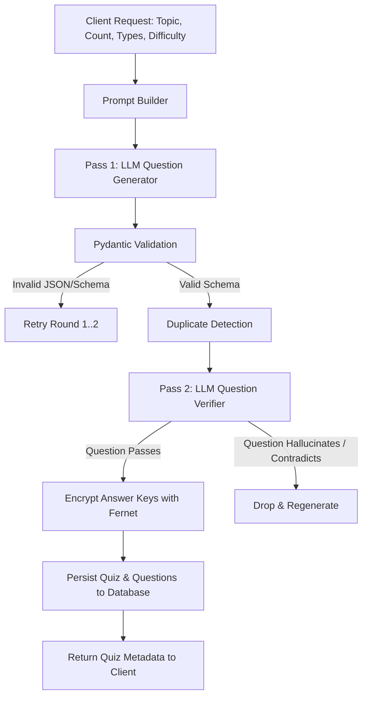

# Backend: Quiz Generation Pipeline

## 1. Overview
The quiz generation pipeline creates pedagogically sound, high-fidelity quiz questions using LLMs (Ollama with `llama3.2` locally, switchable to OpenAI/Anthropic in production).

## 2. Pipeline Architecture & Two-Pass Verification



### Why Two LLM Passes?
1. **Pass 1 (Generator)**:
   Generates creative candidate questions conforming to topic, difficulty (`easy`, `medium`, `hard`), and distribution of types (`mcq`, `true_false`, `short_answer`).
2. **Pass 2 (Verifier)**:
   A dedicated prompt asks the LLM to independently verify:
   - Is the question unambiguous?
   - Is there exactly one correct answer for MCQs?
   - Is the correct answer actually correct given modern scientific/historical facts?
   - Does the explanation justify the answer?
   If the verifier detects ambiguity or factual error, the question is discarded, ensuring students never face broken questions.

## 3. Duplicate Detection
Questions are deduplicated using normalized text comparison and vector/semantic similarity to prevent asking the same core question in slightly varied phrasing within the same quiz.

## 4. Structured Output Guarantees
We require the LLM to output valid JSON matching our Pydantic schema:
```python
class GeneratedQuestion(BaseModel):
    text: str
    type: Literal["mcq", "true_false", "short_answer"]
    options: list[str] | None
    correct_answer: str
    explanation: str
    difficulty: Literal["easy", "medium", "hard"]
```
When using Ollama, `format="json"` is passed, followed by `model_validate_json()` to enforce type safety.
