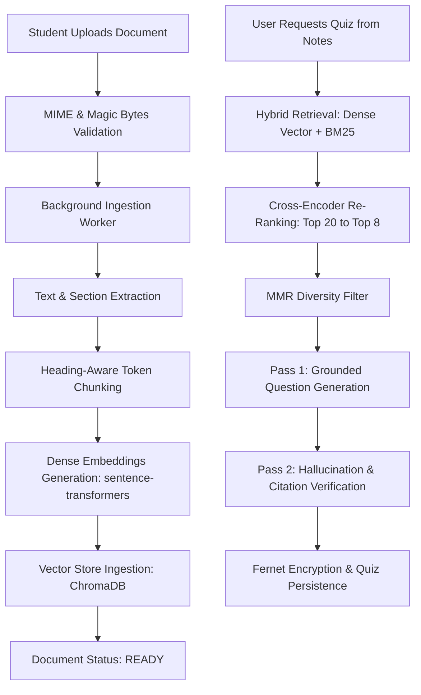

# RAG Architecture: Pipeline Walkthrough

## 1. Overview
The LearnSmart Notes RAG (Retrieval-Augmented Generation) pipeline enables students to generate high-fidelity, pedagogically sound quizzes strictly grounded in their uploaded course notes (PDF, DOCX, TXT).

## 2. Pipeline Sequence

## 3. Guarantees
1. **Zero Hallucination with Source Attribution**:
   Every generated question references a concrete `source_chunk_id` and document excerpt.
2. **Pedagogical Diversity**:
   Maximal Marginal Relevance (MMR) ensures the generated questions span the full breadth of the notes rather than clustering around a single prominent section.
3. **Double Verification**:
   The verifier pass confirms that the cited excerpt factually supports the correct answer before the question is stored.
